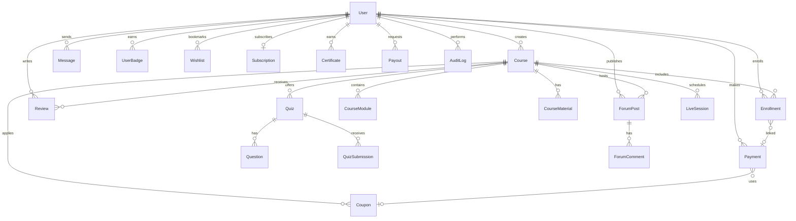

<p align="center">
  
  
  
  
  
  
</p>

<h1 align="center">🎓 EduConnect — Student Tutor Platform</h1>

<p align="center">
  <b>A full-stack, AI-powered online tutoring marketplace built with Flask.</b><br/>
  Connecting students with tutors through courses, live sessions, quizzes, gamification, and secure payments.
</p>

<p align="center">
  <a href="#-features-at-a-glance">Features</a> •
  <a href="#-architecture">Architecture</a> •
  <a href="#-tech-stack">Tech Stack</a> •
  <a href="#-getting-started">Getting Started</a> •
  <a href="#-api-reference">API</a> •
  <a href="#-project-structure">Structure</a> •
  <a href="#-license">License</a>
</p>

---

## ✨ Features at a Glance

| Domain | Highlights |
|---|---|
| 🔐 **Authentication** | Role-based login (Student / Tutor / Admin), email verification, password reset tokens, login streaks |
| 📚 **Course Management** | Create, edit, and publish courses with modules, materials (PDF/DOCX), categories, and difficulty levels |
| 💳 **Payments & Monetization** | Stripe checkout, UPI/QR code payments, discount coupons, subscription plans (monthly/yearly), tutor payouts |
| 🤖 **AI-Powered (Gemini)** | Chatbot assistant, personalized course recommendations, material summarization, content moderation |
| 🎮 **Gamification** | Points, badges, login streaks, leaderboard, milestone rewards |
| 📝 **Quizzes & Certificates** | MCQ quizzes with passing scores, auto-grading, completion certificates with unique codes |
| 📅 **Live Sessions** | Schedule classes via Jitsi Meet / Zoom with interactive calendar view |
| 💬 **Engagement** | Discussion forums, direct messaging, course reviews & star ratings, wishlists |
| 🛡️ **Admin Panel** | Analytics dashboard, tutor/course approval workflow, audit logs, content moderation flags, coupon management |
| 🌍 **Internationalization** | Multi-language support — English, Hindi, Spanish, French (Flask-Babel) |
| 🔌 **REST API** | Swagger-documented API with token auth for courses, enrollments, and user management |
| 📱 **PWA Ready** | Service worker, web manifest, and offline page for installable app experience |

---

## 🏗️ Architecture

```
┌──────────────────────────────────────────────────────────────┐
│                        CLIENT LAYER                          │
│   Browser (Jinja2 Templates + JS)  │  REST API Consumers    │
└───────────────┬──────────────────────────────┬───────────────┘
                │                              │
                ▼                              ▼
┌──────────────────────────────────────────────────────────────┐
│                     APPLICATION LAYER                        │
│                                                              │
│  ┌─────────┐  ┌─────────┐  ┌──────────┐  ┌──────────────┐  │
│  │  Auth   │  │ Student │  │  Tutor   │  │    Admin     │  │
│  │ Routes  │  │ Routes  │  │  Routes  │  │   Routes     │  │
│  └────┬────┘  └────┬────┘  └────┬─────┘  └──────┬───────┘  │
│       │            │            │               │           │
│  ┌────┴────────────┴────────────┴───────────────┴────────┐  │
│  │               CONTROLLERS & FORMS                     │  │
│  └────┬─────────────────┬──────────────────┬─────────────┘  │
│       │                 │                  │                │
│  ┌────▼────┐  ┌─────────▼────────┐  ┌─────▼──────────┐     │
│  │ Payment │  │  Gamification    │  │   AI Service   │     │
│  │ Service │  │    Service       │  │   (Gemini)     │     │
│  └────┬────┘  └────────┬─────────┘  └───────┬────────┘     │
│       └────────────────┼─────────────────────┘              │
│                        ▼                                    │
│  ┌──────────────────────────────────────────────────────┐   │
│  │              FLASK-RESTX  API  LAYER                 │   │
│  │     /api/auth  /api/courses  /api/enrollments        │   │
│  │              Swagger Docs: /api/docs                 │   │
│  └──────────────────────────────────────────────────────┘   │
└──────────────────────────┬───────────────────────────────────┘
                           │
                           ▼
┌──────────────────────────────────────────────────────────────┐
│                       DATA LAYER                             │
│           SQLAlchemy ORM  +  Flask-Migrate (Alembic)         │
│                     SQLite / PostgreSQL                       │
└──────────────────────────────────────────────────────────────┘
```

---

## 🛠️ Tech Stack

| Layer | Technology |
|---|---|
| **Backend** | Python 3.10+, Flask, Flask-SQLAlchemy, Flask-Migrate (Alembic) |
| **Authentication** | Flask-Login, Werkzeug (scrypt hashing), itsdangerous (timed tokens) |
| **API** | Flask-RESTX with auto-generated Swagger/OpenAPI docs |
| **AI** | Google Gemini 2.5 Flash via `google-generativeai` SDK |
| **Payments** | Stripe Checkout + Webhooks, UPI QR Code generation (`qrcode`) |
| **Database** | SQLite (dev) / PostgreSQL (production-ready) |
| **Internationalization** | Flask-Babel (English, Hindi, Spanish, French) |
| **Rate Limiting** | Flask-Limiter (in-memory / Redis) |
| **Frontend** | Jinja2 Templates, Vanilla JS, CSS |
| **PWA** | Service Worker + Web Manifest |
| **File Processing** | PyPDF2 (PDF), python-docx (DOCX) |

---

## 🚀 Getting Started

### Prerequisites

- **Python 3.10+** installed
- **pip** package manager
- *(Optional)* [Stripe CLI](https://stripe.com/docs/stripe-cli) for webhook testing
- *(Optional)* [Google Gemini API Key](https://aistudio.google.com/app/apikey) for AI features

### 1. Clone the Repository

```bash
git clone https://github.com/rahul2615/StudentTutor-Platform.git
cd StudentTutor-Platform/StudentTutor\ Platform
```

### 2. Create a Virtual Environment

```bash
python -m venv venv

# Windows
venv\Scripts\activate

# macOS / Linux
source venv/bin/activate
```

### 3. Install Dependencies

```bash
pip install -r requirements.txt
```

### 4. Configure Environment Variables

```bash
cp .env.example .env
```

Edit `.env` with your credentials:

```ini
# Required
SECRET_KEY=your-secret-key-here
DATABASE_URI=sqlite:///site.db

# Optional — AI Features
GEMINI_API_KEY=your_gemini_api_key

# Optional — Payments (Stripe test keys)
STRIPE_PUBLISHABLE_KEY=pk_test_xxx
STRIPE_SECRET_KEY=sk_test_xxx
STRIPE_WEBHOOK_SECRET=whsec_xxx
STRIPE_MONTHLY_PRICE_ID=price_xxx
STRIPE_YEARLY_PRICE_ID=price_xxx
PLATFORM_FEE_PERCENT=15
```

> 💡 **Note:** The platform runs fully without Stripe or Gemini keys — AI features and payments gracefully degrade to offline/sandbox mode.

### 5. Initialize the Database

```bash
flask db upgrade
```

### 6. Create an Admin Account

```bash
python create_admin.py
```

### 7. *(Optional)* Seed Demo Data

```bash
python seed_demo_data.py
```

### 8. Run the Application

```bash
python run.py
```

Visit **http://localhost:5000** in your browser. 🎉

---

## 👥 User Roles

### 🎓 Student
- Browse and enroll in free/paid courses
- Track progress with module-by-module learning
- Take quizzes and earn certificates
- Join discussion forums and direct message tutors
- Leave reviews and star ratings
- Save courses to wishlist
- Earn points, unlock badges, climb the leaderboard
- Subscribe for unlimited course access (monthly/yearly)
- Get AI-powered course recommendations and chatbot support

### 👨‍🏫 Tutor
- Create courses with modules, materials (PDF/DOCX), pricing
- Schedule live sessions via Jitsi Meet / Zoom
- Create MCQ quizzes with configurable passing scores
- Set up UPI/bank payment details for earnings
- View earnings dashboard and request payouts
- Engage with students via forums and direct messaging
- Upload QR codes for UPI payments

### 🛡️ Admin
- Approve/reject tutor registrations and course submissions
- View platform-wide analytics and revenue reports
- Manage discount coupons (percentage / flat)
- Review AI-flagged content for moderation
- Process tutor payout requests
- Access immutable audit logs of all admin actions
- Bulk approve tutors and courses

---

## 🤖 AI Features (Google Gemini)

The platform integrates **Google Gemini 2.5 Flash** for intelligent automation:

| Feature | Description |
|---|---|
| 💬 **Smart Chatbot** | Context-aware assistant that answers platform FAQs and recommends courses from the live catalog |
| 🎯 **Course Recommendations** | Analyzes enrollment history to suggest complementary courses using AI reasoning |
| 📄 **Material Summarization** | Extracts text from uploaded PDF/DOCX files and generates student-friendly bullet-point summaries |
| 🛡️ **Content Moderation** | Automatically scans course descriptions, forum posts, and comments for inappropriate content with severity levels |

> All AI features gracefully degrade when the API key is not configured — the platform remains fully functional without AI.

---

## 💳 Payment System

### Stripe Integration
- **One-time purchases** — Stripe Checkout for individual courses
- **Subscriptions** — Monthly and yearly plans for unlimited access
- **Webhooks** — Automatic enrollment on successful payment
- **Dev sandbox** — Simulated payment flow when Stripe keys are absent

### UPI / QR Code Payments
- **Dynamic QR codes** — Generated per transaction with amount, payee, and note
- **Manual verification** — Students upload payment proof with UTR reference
- **Tutor setup** — UPI ID, QR code upload, and bank details configuration

### Coupon System
- Percentage or flat discount coupons
- Course-specific or platform-wide applicability
- Usage limits, date-based validity, and active/inactive toggling

### Tutor Earnings
- Real-time earnings dashboard with gross/net breakdown
- Configurable platform fee percentage (default: 15%)
- Payout request system with admin approval workflow

---

## 🎮 Gamification System

Students earn **points** and **badges** through platform engagement:

| Action | Points | Badge |
|---|---|---|
| Login streak (daily) | — | 🔥 Week Warrior (7d), Monthly Master (30d), Century Streak (100d) |
| Enroll in a course | +5 | 👟 First Step (1st enrollment) |
| Pass a quiz | +25 | 🧠 Quiz Master (100% score) |
| Create a forum post | +10 | — |
| Reply to a discussion | +5 | — |
| Submit a review | +15 | — |
| Complete a course | +50 | 🎓 Graduate |
| Points milestones | — | ⭐ Rising Star (100), 📖 Knowledge Seeker (500), 👑 Grand Scholar (1000) |

All achievements are displayed on the **Leaderboard** page.

---

## 🔌 API Reference

The platform exposes a **RESTful API** with interactive Swagger documentation at `/api/docs`.

### Authentication
All API endpoints use **token-based authentication** via `itsdangerous` signed tokens.

```
Authorization: Bearer <token>
```

### Available Namespaces

| Namespace | Endpoints |
|---|---|
| `/api/auth` | Login, register, token generation |
| `/api/courses` | List, search, and view course details |
| `/api/enrollments` | Enroll in courses, track progress |
| `/api/users` | User profiles and management |

### Example: List Courses

```bash
curl -X GET http://localhost:5000/api/courses/ \
  -H "Authorization: Bearer YOUR_TOKEN"
```

---

## 📁 Project Structure

```
StudentTutor-Platform/
│
├── StudentTutor Platform/
│   ├── app/
│   │   ├── __init__.py              # Flask app factory, extensions init
│   │   ├── models.py                # 20+ SQLAlchemy models
│   │   ├── forms.py                 # WTForms for all user inputs
│   │   ├── decorators.py            # Access control decorators
│   │   ├── utils.py                 # Helper utilities
│   │   │
│   │   ├── routes/                  # Blueprint route handlers
│   │   │   ├── auth.py              #   ↳ Login, Register, Password Reset
│   │   │   ├── student.py           #   ↳ Student Dashboard & Courses
│   │   │   ├── tutor.py             #   ↳ Tutor Dashboard & Course CRUD
│   │   │   ├── admin.py             #   ↳ Admin Panel & Analytics
│   │   │   ├── home.py              #   ↳ Landing Page
│   │   │   ├── engagement.py        #   ↳ Forums, Messaging, Reviews, Leaderboard
│   │   │   ├── payment.py           #   ↳ Checkout, Webhooks, Subscriptions
│   │   │   └── ai.py                #   ↳ AI Chatbot & Recommendations
│   │   │
│   │   ├── controllers/             # Business logic controllers
│   │   │   ├── course_controller.py
│   │   │   ├── earnings_controller.py
│   │   │   └── student_controller.py
│   │   │
│   │   ├── services/                # Core service layer
│   │   │   ├── ai_service.py        #   ↳ Gemini AI integration
│   │   │   ├── gamification_service.py  #   ↳ Points, badges, streaks
│   │   │   └── payment_service.py   #   ↳ Stripe, UPI, coupons, payouts
│   │   │
│   │   ├── api/                     # REST API (Flask-RESTX)
│   │   │   ├── __init__.py          #   ↳ Swagger docs at /api/docs
│   │   │   ├── auth_api.py
│   │   │   ├── courses_api.py
│   │   │   ├── enrollments_api.py
│   │   │   ├── users_api.py
│   │   │   └── token_auth.py        #   ↳ Token verification
│   │   │
│   │   ├── templates/               # Jinja2 HTML templates
│   │   │   ├── base.html            #   ↳ Master layout
│   │   │   ├── home.html            #   ↳ Landing page
│   │   │   ├── auth/                #   ↳ Login, Register, Profile
│   │   │   ├── admin/               #   ↳ Dashboard, Approvals, Analytics
│   │   │   ├── student/             #   ↳ Dashboard, Courses, Certificates
│   │   │   ├── tutor/               #   ↳ Dashboard, Course CRUD, Earnings
│   │   │   ├── engagement/          #   ↳ Forums, Chat, Calendar, Quizzes
│   │   │   ├── payment/             #   ↳ Checkout, Pricing, Success/Cancel
│   │   │   ├── ai/                  #   ↳ Chatbot widget
│   │   │   └── errors/              #   ↳ 403, 404, 429, 500 pages
│   │   │
│   │   ├── static/                  # Static assets
│   │   │   ├── css/style.css
│   │   │   ├── main/main.js
│   │   │   ├── manifest.json        #   ↳ PWA manifest
│   │   │   ├── sw.js                #   ↳ Service worker
│   │   │   └── icons/               #   ↳ PWA icons (192px, 512px)
│   │   │
│   │   └── translations/            # i18n translation files
│   │       ├── hi/                  #   ↳ Hindi
│   │       ├── es/                  #   ↳ Spanish
│   │       └── fr/                  #   ↳ French
│   │
│   ├── migrations/                  # Alembic database migrations
│   ├── config.py                    # App configuration
│   ├── run.py                       # Application entry point
│   ├── create_admin.py              # Admin account creation script
│   ├── seed_demo_data.py            # Demo data seeder
│   ├── requirements.txt             # Python dependencies
│   ├── babel.cfg                    # Babel extraction config
│   └── .env.example                 # Environment variable template
│
├── .gitignore
└── README.md
```

---

## 🗃️ Database Models

The platform uses **20+ SQLAlchemy models** organized into logical domains:



---

## 🔒 Security Features

- **Password hashing** — `scrypt` via Werkzeug (industry-standard)
- **CSRF protection** — Flask-WTF on all forms
- **Rate limiting** — Flask-Limiter (10/min login, 5/min registration, 200/min global)
- **Token-based auth** — Time-limited signed tokens (`itsdangerous`)
- **Email verification** — Required before login (configurable)
- **Webhook verification** — Stripe signature validation
- **Audit logging** — Immutable admin action records
- **Content moderation** — AI-powered flag + manual review workflow
- **CORS policy** — Restricted to `/api/*` endpoints
- **Input validation** — WTForms validators on all user inputs

---

## 🌍 Internationalization (i18n)

The platform supports **4 languages** out of the box:

| Language | Code | Status |
|---|---|---|
| 🇬🇧 English | `en` | ✅ Default |
| 🇮🇳 Hindi | `hi` | ✅ Translated |
| 🇪🇸 Spanish | `es` | ✅ Translated |
| 🇫🇷 French | `fr` | ✅ Translated |

Language is auto-detected from the browser's `Accept-Language` header or manually selectable via the language picker in the UI.

---

## 📱 Progressive Web App (PWA)

The platform is **installable** on mobile and desktop:

- ✅ Web App Manifest with app name, icons (192px & 512px), theme color
- ✅ Service Worker for offline caching
- ✅ Offline fallback page
- ✅ "Add to Home Screen" prompt support

---

## 🧪 Development Sandbox

The platform includes **built-in dev/sandbox modes** so you can develop and test without external services:

| Service | Dev Behavior |
|---|---|
| **Stripe** | Simulated checkout flow with one-click payment completion |
| **Gemini AI** | Graceful fallback messages; popularity-based recommendations |
| **Email** | Verification links displayed as flash messages (no SMTP required) |

---

## 📄 License

This project is open source and available under the [MIT License](LICENSE).

---

<p align="center">
  Made with ❤️ by <a href="https://github.com/rahul2615">Rahul</a>
</p>